<picture>
  <source media="(prefers-color-scheme: dark)" srcset="assets/header-dark.svg">
  <source media="(prefers-color-scheme: light)" srcset="assets/header-light.svg">
  
</picture>

<p>
  <a href="https://peportizdg.dev"></a>
  <a href="https://www.linkedin.com/in/peportizdg"></a>
  <a href="mailto:peportizdg@gmail.com"></a>
  <a href="https://peportizdg.dev/cv/portizdg_CV_eng.pdf"></a>
  <a href="https://peportizdg.dev/cv/portizdg_CV_esp.pdf"></a>
</p>

I build software for algorithmic trading: the interface traders keep open all day, and the
automation behind it that they never have to look at.

From 2024 to September 2026 I was on the founding team at **Hybridge**, an algorithmic-trading
fintech in Buenos Aires, and grew from junior full-stack developer to **Product Owner of the front
end and lead for DevOps, infrastructure and version management**. Before that I did cybersecurity
consulting at **KPMG**, and I've traded futures and options myself through A3 Mercados' NOR program.

```console
$ whoami --short
computer engineer (UCA) · front end to FIX session · Linux when the answer is a kernel setting
$ status
focused on independent projects · available for full-time or freelance work
```

### What I've shipped

- **Took a trading platform from scripts to containers.** Dockerized the whole solution and built a
  poller-based rollout that updates 20+ client environments at once while keeping each one's
  customization.
- **Built CI/CD from zero.** GitHub Actions and Bitbucket Pipelines on self-hosted runners: builds,
  images and releases fully automated, plus test and staging environments.
- **Hardened it to bank standards.** Attack-surface reduction, zero-trust access, secrets management,
  and a cleanup of branching and versioning so every release is traceable.
- **Rebuilt the trading front end** (Vue.js) into a product traders are comfortable in for eight
  hours: live market data and strategy state for a whole desk, without dropped frames.
- **Put LLMs to work in production.** An internal support assistant and an automated code reviewer
  that reads every push.
- **Worked close to the metal.** FIX / QuickFIX connectivity, market data and order routing, C/C++
  libraries, Linux tuned for latency.

### Stack

| | |
|---|---|
| **DevOps** | Docker · GitHub Actions · Bitbucket Pipelines · self-hosted runners · AWS · Azure · Terraform |
| **Linux & networking** | Bash · kernel & latency tuning · Nginx · Cloudflare Tunnels / Zero Trust · TLS / ACME · VPNs · DNS |
| **Languages** | Python (asyncio, Pandas, SciPy) · C / C++ · JavaScript / TypeScript · Java (Spring) · SQL |
| **Front end** | Vue.js · WebSockets · real-time UI · UX & product ownership |
| **Trading** | FIX · QuickFIX · ZMQ · market data & order routing · futures & options · market making |
| **AI** | LLM agents · tool & skill design · automated code review · CI integration |
| **Security** | hardening · zero-trust access · secrets management · cyber risk & maturity assessments |

### Public work

Most of what I build runs inside client networks, so the repos are private. You can see the
interfaces recreated, with invented data, at **[peportizdg.dev](https://peportizdg.dev)**.

| Repo | What it is |
|---|---|
| [benchmarkAlgoTrad](https://github.com/peportizdg/benchmarkAlgoTrad) | My thesis testbed. Compares FIX, HTTP/1.1, HTTP/2 and WebSocket for trading: latency, throughput, jitter and behaviour when the connection drops, over loopback and `netem`-shaped networks, with and without TLS. |

### How I work

- **I'd rather delete a ticket than close it.** If something lands in my inbox twice, the third time it's a script.
- **I build from feedback, not assumptions.** I've watched traders work and traded myself, which keeps those conversations short.
- **I work across the whole stack.** CSS in the morning, a FIX session or a kernel setting in the afternoon.
- **Boring infrastructure is the goal.** Nobody should be able to tell a release happened.

<sub>Buenos Aires, Argentina · GMT-3 · Spanish & English</sub>
